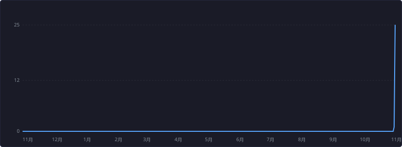

## 到目前为止，已有  次访问

### 你可以从此大概了解我：

- 🌱 正在折腾：网络工具、浏览器隐私加固
- 💻 项目全部免费开源，仓库里有现成成品，拿来就能用
- 📫 如何联系我：在对应仓库提 Issue 就行

### 我的技能集

<table><tr><td>

**[NodeCheck · 节点体检](https://github.com/xiaoyaodev/nodecheck)**
批量检测订阅节点的出口类型、原生/广播与干净度

`Python` `PyQt6` `sing-box` `Windows 成品`

</td></tr></table>

<table><tr><td>

**[浏览器隐私双路线指南](https://github.com/xiaoyaodev/browser-privacy-dual-guide)**
Chrome 融入路线 + Firefox 加固路线中文教程

`浏览器隐私` `user.js` `中文教程`

</td></tr></table>

常用技术：   　语言构成：Python 97.4% · JavaScript 1.6% · Shell 1.0%

### 成就记录

